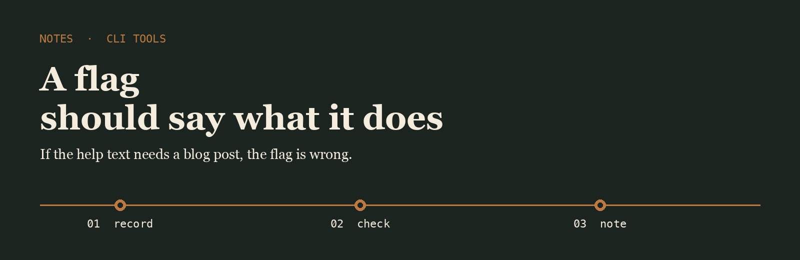
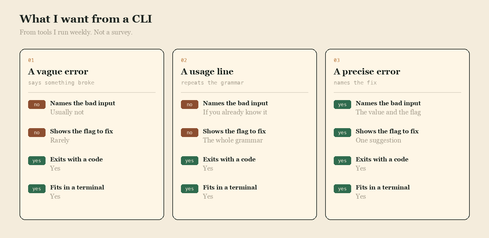

<p align="center">
  
</p>

# Casper Doyle

I keep a short notebook of command-line tools I actually use, mostly in Rust, mostly because the error messages are specific.

## The question

When a tool fails, do you get a sentence you can act on, or a stack you have to reconstruct?

<p align="center">
  
</p>

|  | A vague error | A usage line | A precise error |
| --- | --- | --- | --- |
| Names the bad input | Usually not | If you already know it | The value and the flag |
| Shows the flag to fix | Rarely | The whole grammar | One suggestion |
| Exits with a code | Yes | Yes | Yes |
| Fits in a terminal | Yes | Yes | Yes |

## The line I keep

A line I keep when a tool's error actually helped.

```text
2026-04-12  cargo run -- --since 2d  error: --since wants a date, got 2d. try --since 2026-04-10
```

Most CLIs already parse flags. Fewer of them tell you which flag was wrong.

- [clap](https://github.com/clap-rs/clap) is the parser I reach for when a CLI has more than three flags
- [tokio](https://github.com/tokio-rs/tokio) is what the long-running ones sit on
- [cargo](https://github.com/rust-lang/cargo) is the build I still read when a feature flag surprises me

I keep a fork of each on this account.

## What I pay attention to

- Help text that names the unit
- Errors that quote the bad value
- Tools that fit in one screen
- Defaults that are boring on purpose

## Working with me

Send a short problem statement, a way to see it happen, and what done looks like. I am independent, remote, and usually around during the Dublin afternoon.
